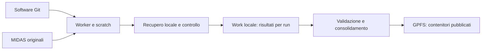

# Separazione di software, controllo e dati

La posizione di un file dipende dal suo ruolo, non dall'estensione: un `.py`
generato come payload è uno snapshot del job; un `.json` con calibrazioni
misurate è un dato; un `.txt` con la selezione dei run è configurazione sorgente.

## Le quattro aree di lavoro

1. **Git — `HFGW/analysis/`.** Algoritmi, programmi, template di job, test,
   configurazioni sorgenti e istruzioni. I test costruiscono dati sintetici:
   non devono richiedere risultati della campagna per funzionare.
2. **Runtime — `HFGW/analysis-runtime/autoreco/Run2/`.** Stati della coda,
   cluster ID, log, payload congelati, credenziali esterne al repository,
   recupero della spool, checkpoint operativi e benchmark. Copie degli output
   ricevuti possono essere conservate nel fascicolo storico del job.
3. **Work — `HFGW/analysis-work/Run2/`.** Area scientifica locale:
   `staging/` per risultati ancora da consolidare, `analysis/` per prodotti
   derivati, `references/` per baseline misurati e `reports/` per i documenti
   renderizzati. Questi file non vanno aggiunti a Git.
4. **GPFS — `flash-data/analysis/autoreco/Run2/`.** Destinazione dei prodotti
   scientifici pubblicati e verificati. Non contiene lo stato della coda.
   La dimensione effettiva guida il confezionamento: un contenitore completo
   per run va bene anche da 1 MB. Evitare molti file per lo stesso run, senza
   imporre una dimensione minima o un calendario giornaliero.

Il flusso da ottenere uniformemente è:

La preparazione di un payload copia i sorgenti necessari e ne conserva la
versione/hash nel runtime. La ricostruzione calcola i risultati; il controllo
decide quando recuperarli; il consolidamento decide quando pubblicarli. Il
worker non deve conoscere l'organizzazione dei report o lo stato del logbook.

Questa è l'architettura di destinazione. I publisher esistenti non sono stati
riscritti durante questo riordino: ad esempio la modalità noise pubblica ora un unico HDF5
autosufficiente per run con i nuovi payload e la modalità FFT temporale usa ancora archivi giornalieri.
La loro unificazione in contenitori per intervallo di run sarà un cambiamento
funzionale distinto, da provare prima del rilancio completo.

## Distinguere le responsabilità del software

I nomi dei programmi correnti restano validi. La riorganizzazione successiva
può separare `examples/` in questi componenti, mantenendo inizialmente launcher
compatibili per le invocazioni già utilizzate:

| Componente | Esempi attuali | Responsabilità |
|---|---|---|
| Ricostruzione/estrazione | `analyze_midas_iq_fft_4ms_paral-pipe.py`, `analyze_midas_iq_noise.py`, `extract_thermometers.py` | MIDAS → prodotti per run, senza decisioni sulla coda |
| Analisi scientifica | `aggregate_iq_noise.py`, `assess_iq_noise_stationarity.py`, `fit_iq_correlation_decay.py` | Aggregazioni, modelli, stabilità e confronti |
| I/O e consolidamento | `fft_daily_archive.py`, lettori dei prodotti | Formati, indici, checksum e lettura dei contenitori |
| Orchestrazione | `autoreco/`, `thermometers_batch.py`, payload e template | Sottomissione, recupero, tentativi e stato |
| Reporting | `reporting/`, `plot_fft_npz.py` | Figure e documenti derivati |

Non rinominare soltanto i file: vanno aggiornati anche import, trasferimenti
HTCondor, launcher, test e documentazione. La separazione in pacchetti Python
può seguire questa mappa, senza dover trasferire in blocco il repository ai worker.
Le varianti FFT storiche restano software, ma non sono tutte entrypoint ufficiali:
il launcher attivo è documentato in `autoreco/README.md`.

## Configurazione e riproducibilità

- Versionare parametri scelti e template; conservare fuori Git stati prodotti
  dall'esecuzione, inventari dei dati e liste di cluster.
- `config/noise_runs.txt` è la selezione dichiarata della campagna.
- `analysis-work/Run2/references/noise_reference.json` è un baseline ottenuto
  da misure: conservarlo con checksum e provenienza, senza includerlo nei test.
- Nel rilancio i risultati scientifici esistenti potranno essere sovrascritti,
  come richiesto. Gli stati precedenti devono essere archiviati o separati,
  affinché non impediscano l'esecuzione dei run ricalcolati.
- In Git conservare notebook senza output ed execution count. I report delle
  campagne, anche se Markdown o JSON, restano nell'area scientifica esterna.

## Riordino eseguito il 7 novembre 2026

I residui rimasti sotto `autoreco/`, gli output HPC/HTC, le prove scientifiche
e le presentazioni renderizzate sono stati spostati in aree esterne. Le copie
storiche mantengono il percorso originale sotto `legacy-repository/`; non sono
state fuse con stati già presenti e potenzialmente più aggiornati.

Gli script utili trovati fra i risultati sono conservati in `tools/diagnostics/`
e `reporting/`. I generatori scrivono i nuovi documenti nell'area `work/reports`.
I default interattivi che puntavano a `GPFS/.../examples` ora puntano al work locale.
L'estrattore dei termometri in esecuzione, il suo checkpoint e il suo CSV non
sono stati spostati: completata la scansione, il prodotto potrà essere trasferito
nell'area scientifica senza interferire con il processo.

Inventario SHA256, mappa dei percorsi, sorgenti precedenti e backup dell'indice
Git sono in `HFGW/analysis-runtime/repository-organization/20261107T101352Z/`.
Gli spostamenti sono stati eseguiti sullo stesso filesystem verificando che
inode, dimensione e data di modifica restassero invariati. Non sono stati
eliminati dati scientifici né riscritti commit precedenti.
